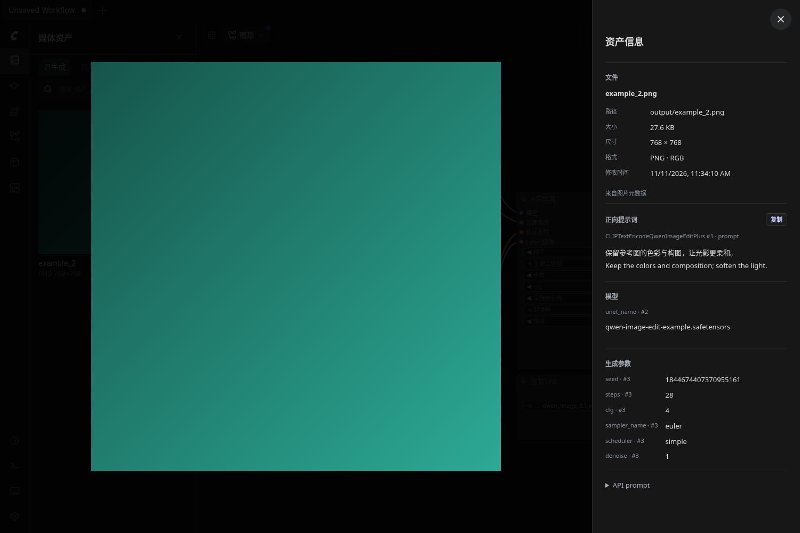
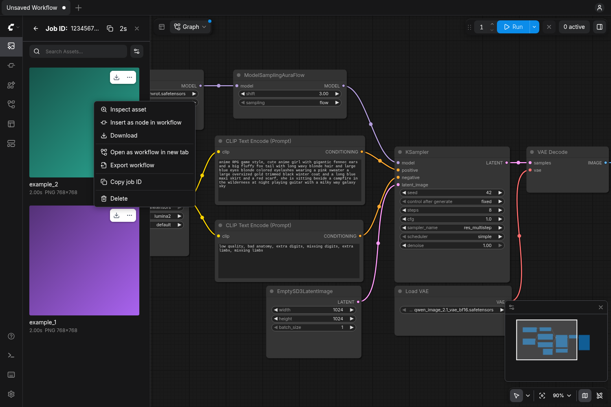

# Better Asset Gallery for ComfyUI

**在原生资产库里，删掉文件，也清理关联的历史记录。打开大图，提示词和生成参数就在右侧。**

一个直接增强 ComfyUI 自带 **Assets / 资产** 面板的插件。右键删除、原生多选、大图预览沿用熟悉的操作，把文件管理和图片信息放到同一个地方。

- 🗑️ **真正删除硬盘文件**：同步清理 ComfyUI 历史输出和资产引用，支持单张与多选。
- 🧩 **保留同一任务中的其他图片**：只删除选中的单张；删除任务分组卡片时，处理整组输出。
- 🔎 **大图右侧查看信息**：文件路径、尺寸、大小、模型、采样器、步数、CFG 和完整 seed。
- 📝 **提示词随图查看与复制**：读取正向、负向提示词及 Qwen Image 编辑指令，也可以展开原始 API prompt 和工作流。

## 看看效果



双击原生资产卡片打开大图，右侧同时展示图片中保存的提示词与参数。左右切图时，信息跟随当前图片更新。



在原生资产右键菜单中选择 **Delete / 删除**，通过页面内的 ComfyUI 确认框后执行删除。截图使用临时样例图片及元数据，展示的是插件界面。

## 原生资产库增强了什么？

以下比较针对本地部署的 **ComfyUI 0.45.0 / 前端 1.58.5**。

| 使用场景 | 原生界面 | 安装本插件后 |
| --- | --- | --- |
| 删除资产 | ⚠️ 清理历史任务或资产条目，文件可能仍在硬盘上 | ✅ 同步删除文件、对应历史输出和资产引用 |
| 一个任务生成多张图 | 删除历史任务会影响整组记录 | ✅ 在展开的任务中只删选中的图片，保留其他输出 |
| 双击图片 | 查看大图 | ✅ 大图右侧同时查看保存的提示词、模型和生成参数 |
| 批量操作 | 原生多选交互 | ✅ 继续使用原生多选与删除确认框 |

## 安装

需要已安装依赖的 ComfyUI **0.45.0** 和前端 **1.58.5**。插件使用 ComfyUI 已有的依赖，无需额外下载模型或安装前端构建工具。

在 ComfyUI 目录中运行：

```bash
git clone https://github.com/cyrus-xc/better-asset-gallery-for-comfyui.git custom_nodes/better-asset-gallery-for-comfyui
```

重新启动 ComfyUI，在浏览器中强制刷新页面，然后打开左侧 **Assets / 资产** 面板。

## 使用

1. **删除单张**：右键资产 → 删除 → 在 ComfyUI 页面内确认。
2. **删除多张**：使用原生多选，再右键删除所选资产或点击原生选择工具栏的删除按钮。
3. **只删一组里的某张**：先展开多输出任务，再对其中的图片执行删除。对带数量标记的任务分组卡片执行删除，会删除该任务的全部已保存输出。
4. **查看图片信息**：双击图片，或右键选择原生的查看操作；右侧显示信息，提示词旁可以直接复制。

支持原生的网格与列表视图、Generated / 生成 和 Imported / 导入 页面。不需要开启 `--enable-assets`；启用资产数据库时，也会清理对应的资产引用。视频文件会同时处理同名 PNG 元数据附件。

### 图片信息从哪里来？

优先读取图片本身保存的 PNG 文本元数据或 WebP / JPEG EXIF；输出图片缺少嵌入提示词时，再读取当前 ComfyUI 运行历史中的对应任务。没有保存过的提示词或参数会显示为空。插件不分析图片内容来补写提示词。

提示词通过工作流连接关系和输出端口区分正向和负向，Qwen Image 2.1 的两路提示词分别显示。保存的负向文字为空时显示“未填写”；其他文字输入按其节点和字段显示。多个采样器或模型会分别标注节点编号。seed 以文本传输和展示，保留完整整数。

### 删除范围

删除会直接移除服务器上 `input` 或 `output` 目录中的目标文件。最后一个已保存输出删除后，移除该任务的历史记录；还有其他输出时，只更新对应输出列表。已有的无关残留历史不会批量清空。

文件删除后若记录清理失败，界面会报告错误；可以对同一资产重试，完成剩余记录清理。

## 版本与开发

当前原生资产菜单没有公开的插件扩展接口，本插件通过独立前端适配层增强现有组件，不修改 ComfyUI 源文件。已验证的前端版本为 **1.58.5**；其他版本需要重新验证组件接口。

测试和接口依据见 [开发说明](docs/development.md)。

采用 [GPL-3.0-or-later](LICENSE) 开源许可。
